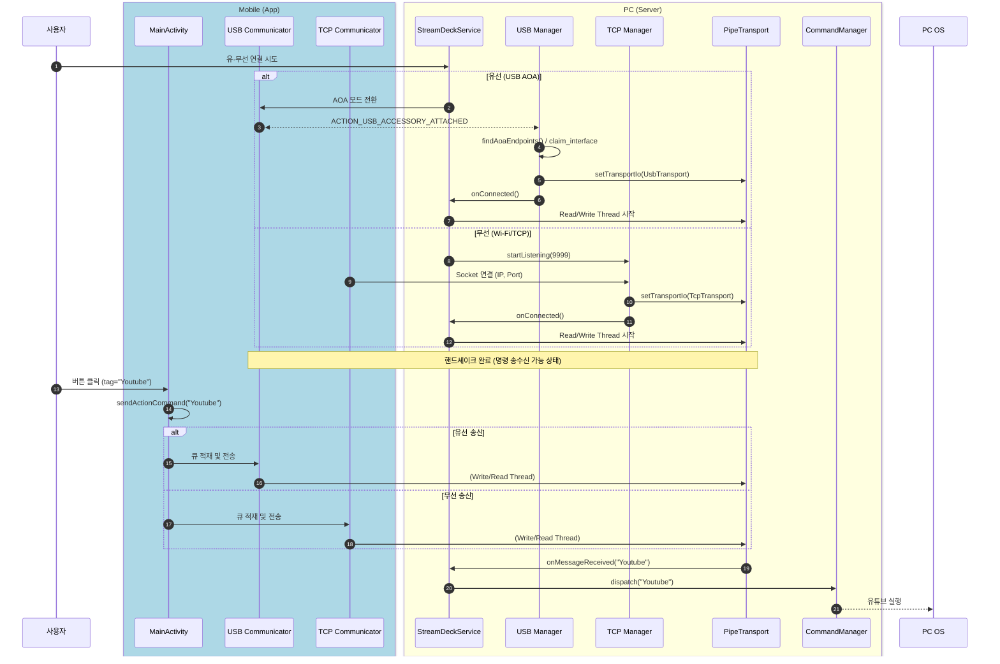

## 1. 개요

### MobileStreamDeck

사용자의 스마트폰을 유선(USB) 및 무선(Wi-Fi) 환경에서 PC와 안정적으로 연동하여 앱 실행, 볼륨 조절 등 시스템 제어를 쉽고 빠르게 수행할 수 있도록 설계되었습니다.

## 2. 기술 스택

| 구분 | 플랫폼 / 언어 |
| --- | --- |
| Mobile (Client) | Android / Java |
| PC (Server) | C++|

**주요 기술** : USB serial 통신 , TCP/IP 소켓 통신 , 멀티쓰레드

## 3. 기능 동작




## 4. 프로젝트 구조

### PC (`pc/src/`)

```text
pc/src/
├── core/
│   ├── UsbManager.h/.cpp
│   ├── TcpManager.h/.cpp
│   └── CommandManager.h/.cpp
├── service/
│   └── StreamDeckService.h/.cpp
├── transport/
│   ├── TransportInputOutput.h
│   ├── Transport.h/.cpp
│   ├── PipeTransport.h/.cpp
│   ├── UsbTransport.h/.cpp
│   └── TcpTransport.h/.cpp
├── protocol/
│   ├── AoaConstants.h
│   └── AoaProtocol.h/.cpp
├── interface/
│   ├── IConnectionObserver.h
│   └── IMessageObserver.h
└── utils/
    ├── Logger.h
    └── PlatformLauncher.h/.cpp
```

### Android (`app/src/main/`)

```text
app/src/main/
├── java/com/pkj/app/streamdeckcontroller/
│   ├── MainActivity.java
│   ├── usb/
│   │   └── AoaCommunicationManager.java
│   └── tcp/
│       └── tcpCommunicator.java
├── res/
│   ├── layout/
│   │   └── activity_main.xml
│   ├── values/
│   │   └── strings.xml
│   └── drawable/
│       └── ic_action_play.xml
└── AndroidManifest.xml
```

## 5. Setup 

### PC

**1. WinUSB Driver Installation (Windows Only)**
You only need to install the WinUSB driver the **first time** your device switches to AOA mode.

1. Download [Zadig](https://zadig.akeo.ie/).
2. Connect your Android device to your PC via USB.
3. Run `StreamDeckPC` and attempt a handshake (the device will switch to AOA mode).
4. Open Zadig, go to **Options**, and check **List All Devices**.
5. Select `Android Accessory` (VID: 18D1, PID: 2D01) from the dropdown.
6. Set the target driver to **WinUSB**, then click **Install/Replace Driver**.

**2. Build**
Configure and build the project using CMake:

bash
cmake -B build -S . -DCMAKE_BUILD_TYPE=Debug
cmake --build build --config Debug

**3. Run**

build\StreamDeckPC.exe

### Android

**1. Build**
Build the project to generate the APK.

**2. Install**
Transfer and install the APK onto your Android device.